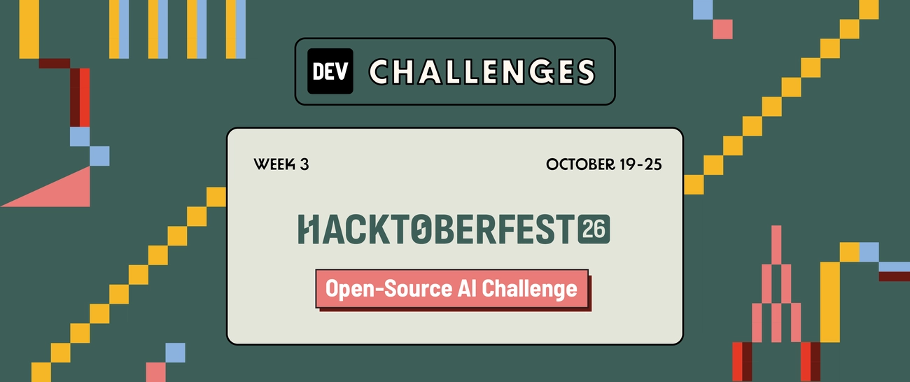
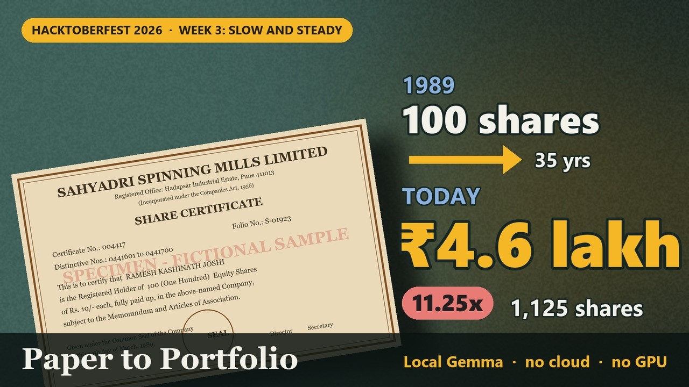
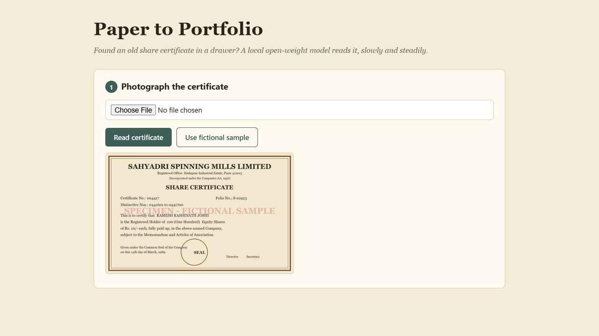
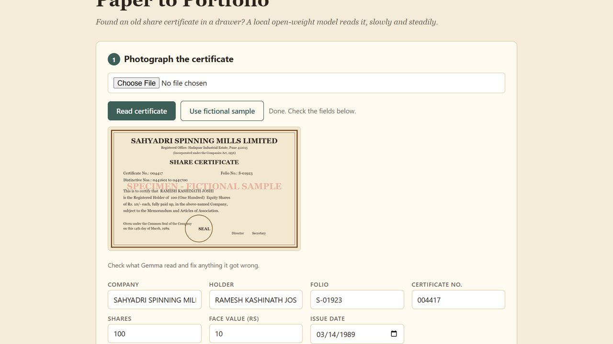
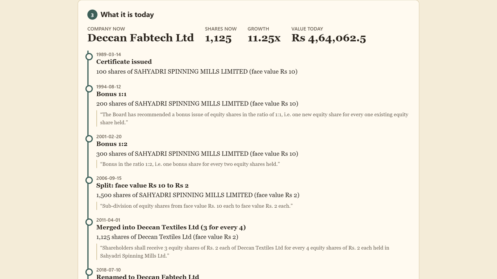
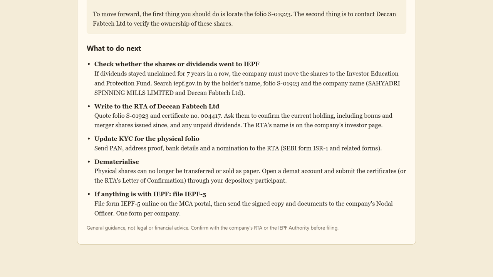

# Paper to Portfolio

**Found an old share certificate in a drawer? Take a photo, paste the company's announcement history, and find out what those shares became: every bonus, split, merger and rename since the day it was printed, what they're worth today, and how to claim them.** A local [Gemma](https://ollama.com/library/gemma4) model reads the paper and the filings, and plain Python does every calculation, so a family's name and folio number never leave the laptop.

Built for DEV's [Hacktoberfest Open-Source AI Challenge, Week 3: Slow and Steady](https://dev.to/challenges/hacktoberfest-week3-2026-10-19). 📝 **[Read the full story on DEV](https://dev.to/rahullkumr/paper-to-portfolio-a-local-gemma-reads-the-old-share-certificate-in-your-drawer-but-never-does-b4c)**

[](https://youtu.be/qGk3mJ9d5nk)

▶ **[Watch the demo video](https://youtu.be/qGk3mJ9d5nk)** (sound on for the narration)

## Features

- **Reads the certificate.** Company, holder, folio, certificate number, shares, face value and issue date, from one photo. Every field stays editable, because a 40-year-old photocopy won't always be clean.
- **Finds what changed the shares.** Paste the corporate-announcement history from the exchange website or annual reports. Gemma skips dividends and AGMs and keeps only bonuses, splits, consolidations, mergers and renames.
- **Evidence or it's thrown out.** Every event must quote the sentence it came from. If the quote isn't in your text word for word, or the ratio is missing, the event is rejected and shown in red.
- **Exact maths, never the model.** `fractions.Fraction` walks the count forward and floors after each step, as Indian companies do (fractional entitlements are paid in cash). The fraction is shown too.
- **Explains it in your language.** A short plain-words summary in English, Hindi, Marathi, Bengali or Tamil, written only from the computed numbers.
- **What to do next.** A fixed, human-written checklist: IEPF search, the RTA, KYC, transmission if the holder has died, demat, and IEPF-5.

| Upload | Gemma read it | Traced to today | What to do next |
|---|---|---|---|
|  |  |  |  |

<sub>Screenshots use the fictional specimen certificate and made-up company in `samples/`.</sub>

## How it works

```
Browser page (one HTML file)  ──>  Python server on 127.0.0.1 (standard library only)
  certificate photo         ──────>  Gemma 4 in Ollama: photo -> certificate fields (JSON schema)
  pasted announcements      ──────>  Gemma 4: text -> events + quoted evidence (JSON schema)
                                     ledger.verify(): quote must appear in the text, fields complete
                                     ledger.trace(): exact fractions, floor, timeline
                                     Gemma 4: computed facts -> plain-words summary
  timeline, value, checklist <─────  claim.checklist(): fixed human-written steps
                    everything stays on this laptop
```

**Gemma reads and writes, code counts.** [`p2p/gemma.py`](p2p/gemma.py) sends the photo and the pasted text to `gemma4:e4b` with strict JSON schemas, so every event comes back with typed fields (`give`/`per`, `from_fv`/`to_fv`, `into`) and an `evidence` quote. [`p2p/ledger.py`](p2p/ledger.py) rejects any event whose quote isn't in the source, accepts Indian `DD-MM-YYYY` dates, and does all the arithmetic. [`p2p/claim.py`](p2p/claim.py) is fixed text on purpose: a wrong legal step can cost a family months. The summary prompt gets only the computed timeline and is told to use only those numbers.

## Run it

Needs **Python 3.12+** and **[Ollama](https://ollama.com/download)**, plus about 7 GB of disk for the model. No extra Python packages. No GPU needed: tested on an i7-13700H with 16 GB RAM and Intel Iris Xe, where reading the certificate takes 38 to 84 s and tracing plus the summary about 3 minutes.

```bash
ollama pull gemma4:e4b
git clone https://github.com/Rahullkumr/paper-to-portfolio.git
cd paper-to-portfolio
python -m p2p.server
```

Open **http://localhost:8765** and click **Use fictional sample**, then **Read certificate**, then **Trace to today**. Settings via environment: `P2P_MODEL` (default `gemma4:e4b`), `OLLAMA_URL`, `PORT`.

**Tests** (no model needed; they also run in GitHub Actions on every push):

```bash
python -m unittest -v
```

The sample data is in [`samples/`](samples/). Regenerate the certificate image with `python samples/make_sample_certificate.py` (needs Pillow).

## Limitations

- **You paste the history.** The tool doesn't fetch filings itself; it only trusts text you give it, and every event is checked against that text.
- **CPU speed.** About 4 to 5 minutes per certificate on a laptop without a GPU. Slow and steady.
- **Old photocopies.** Faded or tilted certificates can be misread. Check the fields before tracing.
- **Value needs today's price.** Enter it yourself; there's no live market data.
- **Not legal or financial advice.** Confirm with the company's Registrar and Transfer Agent or the IEPF Authority before filing anything.

## Built with

[Gemma 4](https://ollama.com/library/gemma4) · [Ollama](https://ollama.com) · Python standard library (`http.server`, `fractions`, `unittest`) · plain HTML, CSS and JavaScript · demo narration by [ElevenLabs](https://elevenlabs.io) · agent sessions on [Entire](https://entire.com/gh/Rahullkumr/paper-to-portfolio/commit/83893ddd41a6b0a02eb171d1582772a11948174d)

## License

[MIT](LICENSE) © 2026 Rahul Kumar
